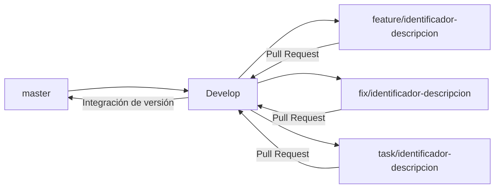

# Contribuir a Vialtros

Guía de trabajo para contribuir al backend, frontend, documentación e
infraestructura de Vialtros.

## Tabla de contenido

- [Antes de empezar](#antes-de-empezar)
- [Estrategia de ramas](#estrategia-de-ramas)
- [Flujo de trabajo](#flujo-de-trabajo)
- [Convención de mensajes de commit](#convención-de-mensajes-de-commit)
- [Pull Requests](#pull-requests)
- [Checks y validación](#checks-y-validación)
- [Revisión y aprobación](#revisión-y-aprobación)

## Antes de empezar

Clona el repositorio y configura la identidad que Git usará en tus commits:

```bash
git clone https://github.com/Vialtros-ORG/Vialtros.git
cd Vialtros
git config user.name "Tu Nombre"
git config user.email "tu-correo@ejemplo.com"
```

Usa el correo asociado a tu cuenta de GitHub para que los commits aparezcan
vinculados a tu usuario. No agregues credenciales, claves ni archivos `.env`
al repositorio.

Consulta el [tablero de Trello de Vialtros](https://trello.com/b/Uu3eBPav/vialtros)
para encontrar la tarea asignada y su identificador.

## Estrategia de ramas



- **`master`** — rama de publicación/despliegue.
- **`Develop`** — rama de integración para el trabajo en curso.
- **`feature/`** — funcionalidades nuevas.
- **`fix/`** — correcciones de errores.
- **`task/`** — documentación, configuración, dependencias y otras tareas.

Toda rama de trabajo debe partir de `Develop`, no de `master`. Incluye el
identificador de la tarjeta de Trello en el nombre cuando exista, por ejemplo:
`task/12-guia-contribucion`.

## Flujo de trabajo

Actualiza `Develop` y crea una rama para tu tarea:

```bash
git switch Develop
git pull --ff-only origin Develop
git switch -c feature/12-nombre-de-la-tarea
```

Usa el prefijo `fix/` para una corrección o `task/` para otro tipo de trabajo.
Sustituye `12` por el identificador de tu tarjeta de Trello. Si la tarea no
tiene tarjeta, acuerda su referencia con el equipo antes de inventar un
identificador.

Realiza cambios pequeños y enfocados. Antes de confirmar, revisa qué vas a
incluir:

```bash
git status
git diff --check
git diff
```

Agrega explícitamente los archivos pertinentes, crea commits descriptivos y
publica la rama:

```bash
git add ruta/al/archivo
git commit -m "docs: agrega guía para contribuir"
git push -u origin feature/12-nombre-de-la-tarea
```

Para publicar cambios posteriores, usa `git push`.

## Convención de mensajes de commit

Usa un prefijo breve que describa el tipo de cambio:

| Prefijo | Uso |
| --- | --- |
| `feat:` | Nueva funcionalidad |
| `fix:` | Corrección de un error |
| `docs:` | Documentación |
| `style:` | Formato sin cambios de comportamiento |
| `refactor:` | Cambio interno sin alterar el comportamiento |
| `test:` | Pruebas |
| `chore:` | Mantenimiento, configuración o dependencias |

Ejemplo: `docs: agrega guía para contribuir`.

## Pull Requests

Integra toda rama de trabajo a `Develop` mediante un Pull Request (PR); no
hagas push directo a `Develop` ni a `master`. En la descripción del PR incluye:

- **Qué cambió** y el motivo.
- **Tarea asociada:** identificador y enlace a la tarjeta de Trello.
- **Validación:** comandos ejecutados y sus resultados; menciona también lo que
  no se pudo ejecutar.
- **Imágenes de prueba:** adjunta una captura de pantalla o el resultado de una
  prueba, como solicita la plantilla del Pull Request.

Si existe un issue de GitHub relacionado, enlázalo también. Asigna una persona
revisora y sigue los requisitos de aprobación y protección de ramas configurados
en el repositorio. Al abrir el PR, selecciona `Develop` como rama de destino.

## Checks y validación

El workflow **CI** se ejecuta en cada Pull Request. Incluye estos trabajos:

- **Backend:** construye la imagen Docker, ejecuta `python manage.py check`,
  ejecuta `python manage.py test` y verifica el arranque del servicio.
- **Frontend:** instala dependencias con `npm ci`, ejecuta Jest y construye la
  aplicación.
- **Docker Compose:** valida la configuración, inicia la pila completa,
  ejecuta las pruebas del backend con PostgreSQL y comprueba respuestas HTTP
  del frontend y Django.
- **Calidad de cambios:** comprueba errores de whitespace con `git diff
  --check`, valida enlaces locales del README y aplica markdownlint a los
  archivos Markdown modificados.

Si un check falla, abre el detalle del workflow, identifica el primer paso
fallido, corrige el problema en la misma rama y vuelve a publicar los cambios.
Los checks aplican a los Pull Requests aunque el cambio no afecte directamente
al backend o frontend.

### Validación local del frontend

Desde `frontend/`:

```bash
npm ci
npm test -- --watchAll=false --passWithNoTests
npm run build
```

Las pruebas deben terminar correctamente. `--passWithNoTests` permite que Jest
termine con éxito cuando todavía no haya pruebas. El build debe finalizar sin
errores.

### Validación local del backend

Desde la raíz del proyecto, con Docker instalado y las variables de entorno de
desarrollo configuradas:

```bash
docker compose config --quiet
docker compose up --build --detach
docker compose exec backend python manage.py check
docker compose exec backend python manage.py test
docker compose down
```

El check de Django debe finalizar sin errores y las pruebas deben terminar con
resultado exitoso. `docker compose down` detiene y elimina los contenedores, no
uses `-v` si necesitas conservar los volúmenes de datos.

También puedes ejecutar `python manage.py check` y `python manage.py test`
desde `backend/` si tienes instaladas las dependencias de
`backend/requirements.txt` y configurado el entorno requerido.

## Revisión y aprobación

1. Abre el Pull Request hacia `Develop` y asígnalo a una persona revisora.
2. Atiende los comentarios relacionados con errores, integración o contratos
   compartidos antes de solicitar el merge.
3. Si se solicitan cambios, continúa trabajando en la misma rama y actualiza
   el PR.
4. El merge se realiza cuando se hayan satisfecho los checks y las reglas de
   aprobación configuradas en GitHub.
5. La integración de `Develop` a `master` corresponde al flujo de publicación
   del proyecto.

Mantén la tarjeta de Trello vinculada a la rama y al Pull Request durante todo
el trabajo para conservar la trazabilidad.
