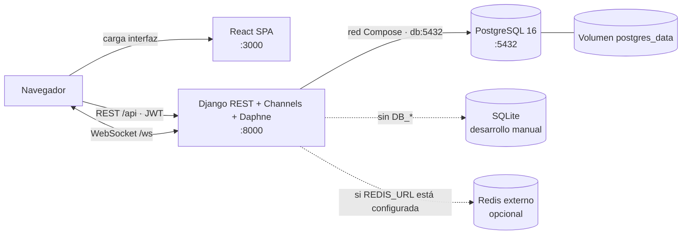

<p align="center">
  
</p>

<h1 align="center">Vialtros</h1>

<p align="center">
  <strong>Gestión de rutas y seguimiento GPS en tiempo real.</strong>
</p>

<p align="center">
  
  
  
  
</p>

<p align="center">
  <a href="#inicio-rápido">Inicio rápido</a> ·
  <a href="#arquitectura">Arquitectura</a> ·
  <a href="#configuración">Configuración</a> ·
  <a href="#pruebas">Pruebas</a> ·
  <a href="#documentación">Documentación</a> ·
  <a href="#contribuir">Contribuir</a>
</p>

---

Vialtros conecta la operación de rutas con una aplicación web para administración,
conductores y pasajeros. El frontend React consume una API REST y canales
WebSocket del backend Django; PostgreSQL conserva los datos en el entorno Docker
Compose.

## Inicio rápido

### Requisitos

- Git.
- Docker Desktop en Windows/macOS, o Docker Engine con Docker Compose v2 en Linux.
- Puertos locales `3000`, `5432` y `8000` disponibles.

No necesitas instalar Python, Node.js ni PostgreSQL en el host para ejecutar el
stack con Docker Compose.

### Instalar y ejecutar

Clona el repositorio y crea el archivo local de variables de entorno:

```bash
git clone https://github.com/Vialtros-ORG/Vialtros.git
cd Vialtros
cp .env.example .env
```

En Windows PowerShell, usa `Copy-Item .env.example .env` en lugar de `cp`.
Edita `.env` y reemplaza los valores de ejemplo, en especial
`POSTGRES_PASSWORD` y `DJANGO_SECRET_KEY`. No compartas ni subas ese archivo.

Construye las imágenes e inicia los servicios:

```bash
docker compose up --build -d
docker compose ps
```

El backend aplica las migraciones al arrancar. Crea primero un superusuario
de Django de forma interactiva:

```bash
docker compose exec backend python manage.py createsuperuser
```

`createsuperuser` habilita el administrador de Django, pero conserva el rol
`user` de Vialtros. Para completar la cuenta administradora de la aplicación:

1. Entra en [Admin Django](http://localhost:8000/admin/) con la cuenta creada.
2. En **Users**, abre esa cuenta y, en **Información adicional**, cambia
   **Role** a **Admin**. Guarda los cambios.
3. Inicia sesión en [Vialtros](http://localhost:3000) con esa cuenta. Si ya
   habías iniciado sesión, sal y vuelve a entrar para actualizar el rol.

El rol `admin` permite acceder a los endpoints administrativos de la API;
`is_staff` e `is_superuser` por sí solos no conceden ese permiso.

La aplicación **no incluye credenciales de administrador preconfiguradas**.

| Servicio | Puerto del host | Dirección / uso |
| --- | --- | --- |
| Frontend React | `3000` | [http://localhost:3000](http://localhost:3000) |
| API y WebSocket Django | `8000` | API: [http://localhost:8000/api/](http://localhost:8000/api/); Admin: [http://localhost:8000/admin/](http://localhost:8000/admin/) |
| PostgreSQL | `5432` | Conexiones desde herramientas locales; backend usa `db:5432` dentro de Compose. |

Detén los servicios conservando los datos con `docker compose down`. El volumen
`postgres_data` persiste entre reinicios. `docker compose down -v` también
elimina ese volumen y la base de datos local.

## Arquitectura



En Compose se inician `frontend`, `backend` y `db`. Redis no forma parte del
stack predeterminado; Channels usa la capa en memoria si no se configura
`REDIS_URL`. SQLite se usa en desarrollo manual cuando no se definen variables
de conexión PostgreSQL.

## Configuración

Compose carga las variables del archivo `.env` ubicado en la raíz. La plantilla
versionada es [.env.example](.env.example); la guía completa de variables y los
dos modos de desarrollo están en [docs/variables-entorno.md](docs/variables-entorno.md).

| Variable | Uso |
| --- | --- |
| `POSTGRES_DB`, `POSTGRES_USER`, `POSTGRES_PASSWORD` | Base de datos y usuario PostgreSQL; Compose los comparte con Django. |
| `DJANGO_SECRET_KEY` | Clave de Django. Usa un secreto propio fuera de pruebas locales. |
| `DJANGO_DEBUG` | Activa o desactiva el modo debug (`True`/`False`). |
| `DJANGO_ALLOWED_HOSTS` | Hosts permitidos por Django, separados por comas. |
| `CORS_ALLOWED_ORIGINS` | Orígenes web autorizados; por defecto `http://localhost:3000`. |
| `FRONTEND_URL` | URL usada para enlaces de restablecimiento de contraseña; por defecto `http://localhost:3000`. |
| `REACT_APP_API_URL`, `REACT_APP_WS_URL` | URLs del API y WebSocket compiladas en el frontend. |
| `REACT_APP_GOOGLE_MAPS_API_KEY`, `REACT_APP_GOOGLE_MAPS_MAP_ID` | Clave del navegador para Google Maps y Map ID opcional. |
| `REACT_APP_GOOGLE_ROUTES_API_KEY` | Clave opcional de Google Routes; puede reutilizar la clave de Maps. |
| `REACT_APP_MAPBOX_TOKEN` | Token público opcional para el componente alternativo Mapbox. |
| `REACT_APP_ROUTING_API_URL` | URL opcional de un servicio compatible con OSRM; por defecto se usa su servidor público de demostración. |

Las variables `REACT_APP_*` se incorporan al JavaScript que recibe el navegador;
no pongas secretos privados en ellas. Las claves de mapas son visibles para el
cliente: cada integrante debe configurar claves propias y restringir su uso
por API y dominio en el proveedor. Consulta la guía de
[mapas y rutas](docs/mapas.md) para crear y configurar las claves. Si cambias
una variable de frontend en `.env`, reconstruye la imagen con
`docker compose up --build -d frontend`.

## Pruebas

Con el stack levantado, ejecuta las comprobaciones y la suite del backend:

```bash
docker compose exec backend python manage.py check
docker compose exec backend python manage.py test
```

Las pruebas del frontend se ejecutan desde `frontend/`:

```bash
npm ci
npm test -- --watchAll=false --passWithNoTests
npm run build
```

El workflow de CI ejecuta además la integración Docker Compose contra
PostgreSQL, verifica respuestas HTTP y revisa Markdown y enlaces locales.
Consulta [docs/ci-checks.md](docs/ci-checks.md) para el detalle de cada check.

## Stack tecnológico

| Área | Tecnología |
| --- | --- |
| Backend | Python 3.14 en Docker · Django · Django REST Framework · Channels · Daphne |
| Frontend | React 19 · Create React App (`react-scripts`) · Tailwind CSS · React Router |
| Persistencia en Compose | PostgreSQL 16 (`postgres:16-alpine`) |
| Persistencia en desarrollo manual | SQLite por defecto; PostgreSQL configurable |
| Mapas | Google Maps / Places / Routes, OSRM y OpenStreetMap; Mapbox opcional |
| Calidad e integración | Docker Compose · GitHub Actions |

Las dependencias Python no están fijadas a una versión concreta en
`backend/requirements.txt`; por ello no se publica aquí una versión exacta de
Django. Los detalles de componentes y límites están en
[docs/arquitectura.md](docs/arquitectura.md).

## Documentación

| Guía | Contenido |
| --- | --- |
| [docs/README.md](docs/README.md) | Índice de guías técnicas |
| [docs/arquitectura.md](docs/arquitectura.md) | Componentes, responsabilidades y diagramas Mermaid |
| [docs/docker-compose.md](docs/docker-compose.md) | Servicios, puertos, configuración y operación del stack |
| [docs/variables-entorno.md](docs/variables-entorno.md) | Variables para Compose y desarrollo manual |
| [docs/api.md](docs/api.md) | Endpoints REST y WebSocket |
| [docs/modelos.md](docs/modelos.md) | Entidades y relaciones de datos |
| [docs/frontend.md](docs/frontend.md) | Páginas, componentes y servicios del frontend |
| [docs/mapas.md](docs/mapas.md) | Proveedores de mapas, creación y restricciones de claves, variables, fallbacks y solución de problemas |
| [docs/ci-checks.md](docs/ci-checks.md) | Workflows y validaciones automáticas |
| [docs/despliegue.md](docs/despliegue.md) | Modos de ejecución y workflows de despliegue disponibles |
| [CONTRIBUTING.md](CONTRIBUTING.md) | Ramas, commits, Pull Requests y revisión |

## Contribuir

El trabajo se integra mediante Pull Request (PR) hacia `Develop`; no trabajes
directamente sobre `Develop` ni abras la PR hacia `master`. Vincula la tarea al
[tablero de GitHub Projects](https://github.com/orgs/Vialtros-ORG/projects/1)
y sigue estos pasos.

### 1. Actualiza `Develop`

Desde la carpeta del repositorio, verifica que no tengas cambios locales que
puedas perder y actualiza la rama base:

```powershell
git status --short
git switch Develop
git fetch origin
git pull --ff-only origin Develop
```

Si tienes cambios propios sin guardar, consérvalos antes de cambiar de rama.
No incluyas trabajo ajeno o no relacionado con tu PR.

### 2. Crea una rama temporal

Crea la rama desde el `Develop` actualizado. Usa minúsculas, guiones y el
número del issue de GitHub asociado cuando exista:

| Tipo de cambio | Ejemplo |
| --- | --- |
| Funcionalidad | `feat/123-busqueda-de-rutas` |
| Corrección | `fix/123-error-de-seguimiento` |
| Documentación | `docs/123-guia-de-mapas` |
| Tarea técnica | `task/123-actualizar-dependencias` |

Si el elemento de GitHub Projects no tiene issue asociado, usa una descripción
corta que identifique el cambio.

```powershell
git switch -c docs/123-guia-de-mapas
git branch --show-current
```

### 3. Implementa y valida

Limita la rama a la tarea vinculada y ejecuta las validaciones pertinentes.
Como mínimo, revisa los cambios y errores de formato:

```powershell
git diff --check
git status --short
git diff
```

Ejecuta pruebas, build o lint según las áreas modificadas. Los comandos de
referencia están en [Pruebas](#pruebas) y los checks automáticos en
[docs/ci-checks.md](docs/ci-checks.md). Registra en la PR cada comando
ejecutado y su resultado real.

### 4. Crea commits

Agrega solo los archivos de la tarea, revisa lo preparado y usa mensajes
concisos siguiendo la convención `<tipo>: <descripción>`:

```powershell
git add README.md docs\archivo-modificado.md
git diff --cached
git commit -m "docs: documentar configuración de mapas"
git status --short
```

Tipos habituales: `feat`, `fix`, `docs`, `test`, `refactor`, `ci` y `chore`.
No agregues `.env`, claves de API, contraseñas ni archivos generados.

### 5. Publica y abre la PR

Integra los cambios recientes de `Develop` antes de publicar:

```powershell
git fetch origin
git rebase origin/Develop
```

Resuelve manualmente cualquier conflicto, revisa el resultado y continúa con
`git add <archivos-resueltos>` y `git rebase --continue`. Después, publica la
rama y abre una PR hacia `Develop`:

```powershell
git push -u origin docs/123-guia-de-mapas
```

Completa la [plantilla de PR](.github/PULL_REQUEST_TEMPLATE.md) sin quitar sus
secciones ni checklist. Enlaza el issue o elemento del
[tablero de GitHub Projects](https://github.com/orgs/Vialtros-ORG/projects/1),
solicita revisión y anota los comandos con sus resultados. Consulta también
[CONTRIBUTING.md](CONTRIBUTING.md) para el flujo del equipo.

### 6. Después de integrar la PR

Actualiza tu `Develop` local y elimina la rama temporal:

```powershell
git switch Develop
git fetch origin
git pull --ff-only origin Develop
git branch -d docs/123-guia-de-mapas
```

Elimina también la rama remota desde GitHub cuando la PR se haya integrado.

## Proyecto y equipo

Vialtros es un proyecto académico de gestión de rutas. Consulta el
[repositorio en GitHub](https://github.com/Vialtros-ORG/Vialtros) y el
[tablero de GitHub Projects](https://github.com/orgs/Vialtros-ORG/projects/1),
donde se organiza el trabajo del equipo.
