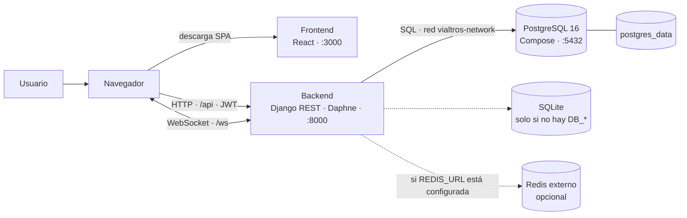
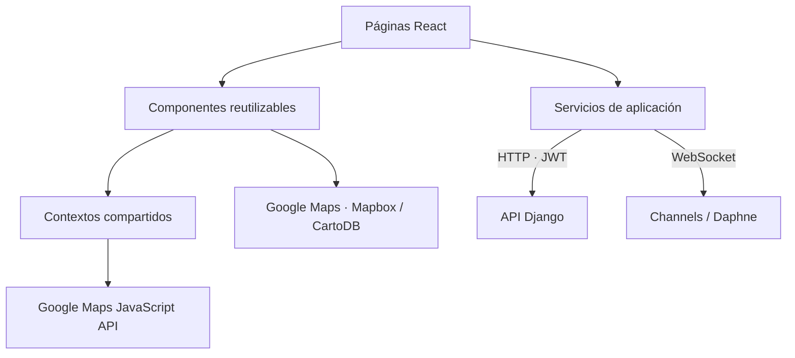
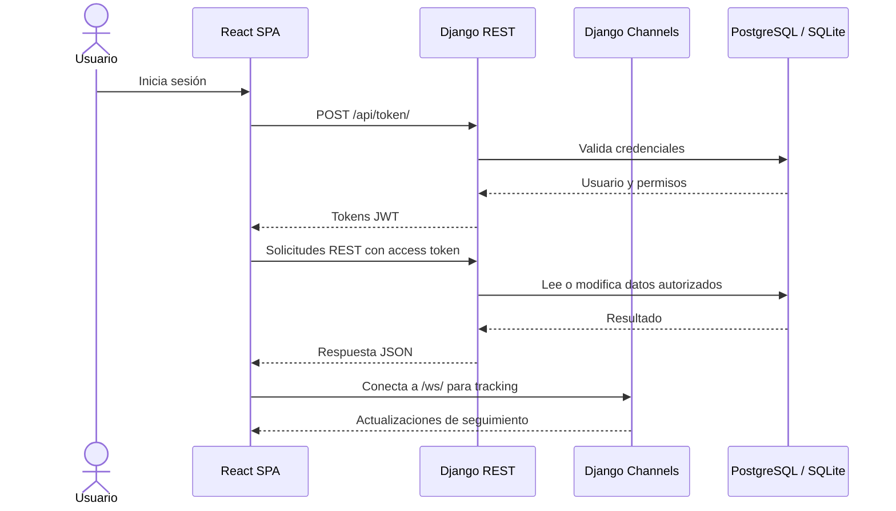

# Arquitectura de Vialtros

Vialtros es una aplicación web cliente-servidor. La interfaz React se sirve como
SPA y se comunica desde el navegador con un backend Django a través de HTTP
(API REST) y WebSocket. El backend usa PostgreSQL en Docker Compose y SQLite
cuando se ejecuta manualmente sin configuración de base de datos.

## Contexto de ejecución

En Compose se construyen y ejecutan los servicios `frontend`, `backend` y
`db`. El navegador se conecta al backend mediante los puertos publicados del
host (`localhost:8000`); dentro de la red Compose, Django llega a PostgreSQL
por `db:5432`. Redis no se inicia en Compose. Sin `REDIS_URL`, Channels usa su
capa en memoria, apropiada para desarrollo de una sola instancia.

## Componentes y responsabilidades

| Componente | Responsabilidad |
| --- | --- |
| `frontend/` | SPA React; páginas, componentes, estado cliente y llamadas HTTP/WebSocket. |
| `backend/core/` | Configuración Django, URLs, ASGI, CORS y selección de base de datos. |
| `backend/users/` | Usuarios y funcionalidades de administración de rutas y personas. |
| `backend/tracking/` | Consumers y enrutamiento WebSocket para seguimiento en tiempo real. |
| `db` en Compose | PostgreSQL 16, accesible desde el host por el puerto `5432` y desde backend por `db:5432`. |

### Capas del frontend

- `frontend/src/pages/` contiene vistas asociadas a rutas de la SPA.
- `frontend/src/components/` contiene componentes de interfaz, incluidos los
  mapas.
- `frontend/src/services/` centraliza acceso al API REST, autenticación,
  operaciones de dominio y WebSocket.
- `frontend/src/context/` integra estado compartido para proveedores, incluido
  Google Maps.

El mapa basado en Google Maps requiere una clave de navegador configurada. El
componente de tracking con Mapbox puede utilizar CartoDB como estilo alternativo
cuando no se configura un token de Mapbox. El cálculo de rutas usa Google Routes
si se suministra una clave compatible; consulta [Mapas y rutas](mapas.md).

## Flujo de datos

Los endpoints de autenticación, las rutas WebSocket y los contratos de
respuesta están documentados en [API](api.md). Los datos persistidos y sus
relaciones se describen en [Modelos de datos](modelos.md).

## Stack y versiones conocidas

| Área | Configuración observada |
| --- | --- |
| Backend | Django, Django REST Framework, Channels y Daphne; imagen `python:3.14-slim`. |
| Frontend | React 19, `react-scripts` 5, Tailwind CSS 3 y React Router 7; imagen Node 20 Alpine. |
| Base de datos Compose | Imagen `postgres:16-alpine`. |
| CI del frontend | GitHub Actions usa Node 22. |
| Base de datos manual | SQLite si no se definen `DB_ENGINE` ni `DB_HOST`; PostgreSQL configurable. |

Las versiones de dependencias Python no están fijadas en
`backend/requirements.txt`; no se presenta una versión exacta de Django como
garantía del entorno. Las versiones declaradas para el frontend están en
`frontend/package.json` y las imágenes base en sus respectivos Dockerfiles.

## Infraestructura y límites

- `docker-compose.yml` publica frontend en `3000`, backend en `8000` y
  PostgreSQL en `5432`; es una configuración de desarrollo local.
- El volumen nombrado `postgres_data` conserva la base cuando se ejecuta
  `docker compose down`; `docker compose down -v` también elimina el volumen.
- Las variables `REACT_APP_*` se compilan en los recursos cliente y son
  visibles en el navegador; nunca deben contener secretos privados.
- Compose aplica migraciones de Django al iniciar el contenedor backend mediante
  `backend/entrypoint.sh`.
- Redis, TLS y proxy inverso no están incluidos en el Compose predeterminado.

Para ejecutar el sistema, consulta [Docker Compose](docker-compose.md). Para la
configuración por ambiente, consulta [Variables de entorno](variables-entorno.md).
