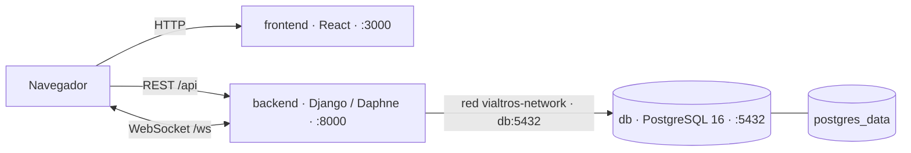

# Entorno local con Docker Compose

Docker Compose ejecuta frontend React, backend Django/Daphne y PostgreSQL en
una red local común. Ejecuta los comandos de esta guía desde la raíz del
repositorio.

## Requisitos

- Docker Desktop o Docker Engine en ejecución.
- Docker Compose v2 (`docker compose`).
- Puertos locales `3000`, `5432` y `8000` disponibles.
- Acceso a Internet para descargar imágenes y dependencias durante el primer
  build.

No es necesario instalar Python, Node.js ni PostgreSQL en el host para esta
modalidad.

## Servicios y puertos

| Servicio | Imagen / build | Puerto publicado | Función |
| --- | --- | --- | --- |
| `frontend` | `frontend/Dockerfile` · Node 20 Alpine | `3000:3000` | Sirve la SPA en `http://localhost:3000`. |
| `backend` | `backend/Dockerfile` · Python 3.14 slim | `8000:8000` | API REST, Admin Django y WebSocket con Daphne. |
| `db` | `postgres:16-alpine` | `5432:5432` | Base de datos PostgreSQL. |

El backend se conecta a PostgreSQL por el nombre de servicio `db`, en el puerto
interno `5432`. El navegador se conecta al backend por `localhost:8000`, que es
el puerto publicado en el host. La API comienza en
`http://localhost:8000/api/`, la administración en
`http://localhost:8000/admin/` y las conexiones WebSocket usan
`ws://localhost:8000/ws/`.

El servicio `db` tiene healthcheck `pg_isready`; el backend espera a que la base
esté saludable. El entrypoint del backend aplica migraciones pendientes antes
de iniciar Daphne. La dependencia del frontend solo ordena el inicio respecto
al backend y no espera a una comprobación de salud del API.

## Configuración

Compose lee `.env` desde la raíz del repositorio o variables del entorno del
proceso. No carga `backend/.env` ni `frontend/.env` como configuración de los
servicios.

Crea tu archivo a partir de la plantilla:

```powershell
Copy-Item .env.example .env
```

En Linux/macOS:

```bash
cp .env.example .env
```

Completa los valores de desarrollo; no publiques `.env` ni uses los valores de
ejemplo en un entorno accesible desde redes no confiables.

| Variable en `.env` | Requerida para Compose | Destino / comportamiento |
| --- | --- | --- |
| `POSTGRES_DB` | Sí | Nombre de la base; el backend la usa como `DB_NAME`. |
| `POSTGRES_USER` | Sí | Usuario de la base; el backend lo usa como `DB_USER`. |
| `POSTGRES_PASSWORD` | Sí | Contraseña de PostgreSQL y del backend. |
| `DJANGO_SECRET_KEY` | Sí | Clave secreta de Django. |
| `DJANGO_DEBUG` | Sí | Django interpreta el texto `True` como modo debug activo. |
| `DJANGO_ALLOWED_HOSTS` | Sí | Hosts de Django separados por comas. |
| `FRONTEND_URL` | No | Origen de frontend para enlaces de restablecimiento; predeterminado `http://localhost:3000`. |
| `CORS_ALLOWED_ORIGINS` | No | Orígenes CORS separados por comas; predeterminado `http://localhost:3000`. |
| `REACT_APP_API_URL` | No | URL de API de navegador en build; predeterminado `http://localhost:8000/api`. |
| `REACT_APP_WS_URL` | No | URL WebSocket de navegador en build; predeterminado `ws://localhost:8000/ws`. |
| `REACT_APP_GOOGLE_MAPS_API_KEY` | No | Clave de navegador de Google Maps, compilada en el frontend. |
| `REACT_APP_GOOGLE_MAPS_MAP_ID` | No | Map ID de Google Maps, compilado en el frontend. |
| `REACT_APP_GOOGLE_ROUTES_API_KEY` | No | Clave de Google Routes; el código también puede reutilizar la clave de Maps. |
| `REACT_APP_MAPBOX_TOKEN` | No | Token de navegador de Mapbox; el mapa de tracking dispone de estilo CartoDB alternativo. |

Las variables `DB_ENGINE`, `DB_NAME`, `DB_USER`, `DB_PASSWORD`, `DB_HOST`,
`DB_PORT` y `DB_SSLMODE` las configura Compose en el contenedor backend. El
backend usa PostgreSQL (`db:5432`) y `DB_SSLMODE=disable` para este entorno
local.

Las variables `REACT_APP_*` se pasan como build args y quedan integradas en los
archivos públicos del frontend. Si cambias una de estas variables, reconstruye
el frontend:

```bash
docker compose up --build -d frontend
```

No incluyas secretos privados en variables `REACT_APP_*`. Las claves de mapas
son visibles para el cliente; protégelas con restricciones de dominio y API en
Google Cloud o Mapbox.

## Levantar y operar el stack

Valida la configuración antes de iniciar los contenedores:

```bash
docker compose config --quiet
```

Construye las imágenes e inicia los servicios en segundo plano:

```bash
docker compose up --build -d
docker compose ps
```

Cuando el stack esté disponible, crea un superusuario de Django (no hay
credenciales preconfiguradas):

```bash
docker compose exec backend python manage.py createsuperuser
```

Este comando conserva `role=user`, aunque activa `is_staff` e `is_superuser`.
Para administrar Vialtros, entra en [Admin Django](http://localhost:8000/admin/),
abre la cuenta en **Users** y cambia **Información adicional → Role** a
**Admin**. Guarda los cambios e inicia sesión en el frontend; si ya tenías una
sesión abierta, sal y vuelve a entrar para actualizar el rol.

La API administrativa exige `role=admin`; ser superusuario de Django no basta.

Comandos útiles:

```bash
docker compose logs --tail=100
docker compose logs -f backend
docker compose exec backend python manage.py check
docker compose exec backend python manage.py test
docker compose exec backend python manage.py showmigrations --plan
docker compose exec db sh -lc 'pg_isready -U "$POSTGRES_USER" -d "$POSTGRES_DB"'
docker compose down
```

`docker compose down` detiene y elimina los contenedores, pero conserva el
volumen `postgres_data`. **`docker compose down -v` elimina también el volumen
y los datos de PostgreSQL.**

## Arquitectura local



Para una vista del sistema y la opción de desarrollo sin Compose, consulta
[Arquitectura](arquitectura.md).
